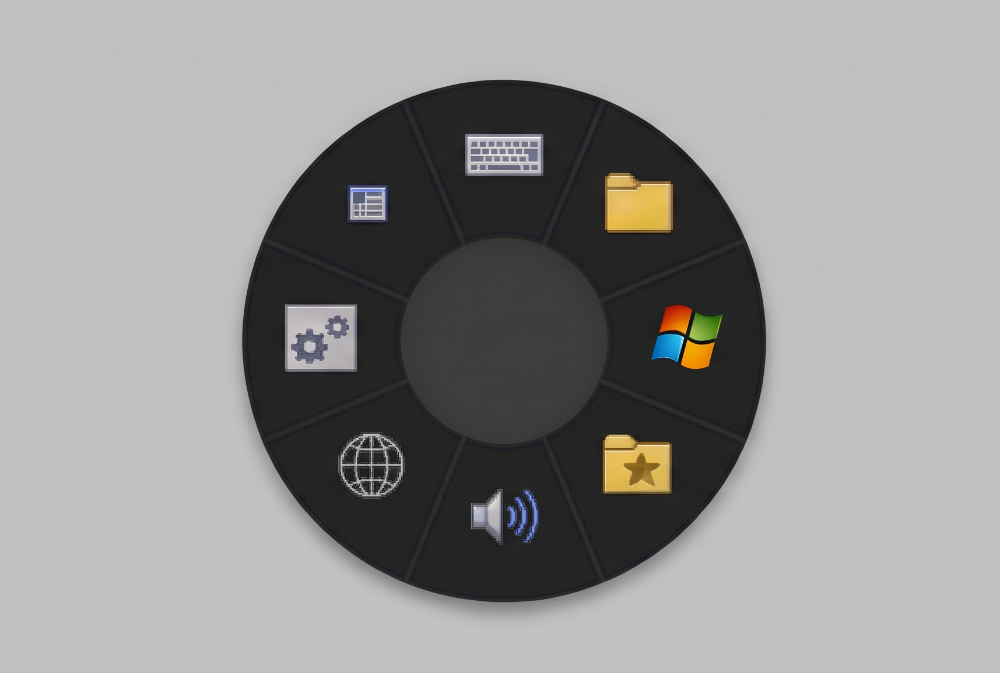

# Radial Wheel
<div align="center">
  
</div>
Demo link -> https://sites.google.com/view/radial-wheel-demo/home
**A radial quick-access menu for Windows.** Press a global hotkey and an 8-sector wheel opens around your cursor. Hover a sector to open a panel above it with keyboard shortcuts, folders, programs, favorites, Windows commands, sound controls, web search and settings.

Written in Python with PySide6. It runs quietly from the system tray, starts with Windows and installs without a console window or administrator rights.

[Bulgarian README](README_bg.md) · Version 1.2.0 · UI available in 20 languages (English by default)
If you like my idea and want to support me a coffee will be amazing so i can keep stay later at night ;) -> https://buymeacoffee.com/nextarbgm
## Features

- **8-sector wheel** at the cursor, clamped to the screen edges. Sectors, clockwise from 12 o'clock: Keyboard, Folders, Windows commands, Favorites, Sound, Internet, Settings, Programs (order is configurable).
- **Contextual panels**
  - *Keyboard:* quick shortcut buttons (add or remove rows and columns), on-screen keyboard, Enter/Space/Backspace and Windows keys.
  - *Folders, Programs, Favorites:* dynamic slots that hold a folder, a program or a file.
  - *Windows commands:* Start, Task Manager, Settings, Lock, Sleep, Restart, Shut Down, Run.
  - *Sound:* volume and default playback device.
  - *Internet:* browser picker, Google search, saved sites.
- **Flexible layout:** one row, a fixed number of tiles per row, or a fixed number of rows. Set tile width and height, icon size, text size, panel width and an overall panel scale, with a live preview.
- **Tile colors:** a color picker with transparency, for a whole panel or for a single slot.
- **Center Delete button:** turns red when you move the cursor onto it and sends a real Delete key press to the window you were using.
- **Tray icon** with a menu: open the wheel, settings, autostart, settings folder, log, **Close** (the hotkey starts it again) and **Exit completely**.
- **Update from a ZIP:** choose or drop an archive in Settings → Update, confirm, and the app replaces its files and restarts. The previous version is kept as a backup.
- **Themes, opacity, scale, custom sector icons, sounds** and 15 settings pages in total.

## Install

No console, no administrator rights.

1. Extract the **whole** ZIP. If Windows marked it as downloaded, right-click the ZIP → Properties → *Unblock* first.
2. Double-click **`install.bat`**. A small installer window shows progress.

The installer:

- finds Python 3.9–3.13, or installs Python 3.12 for your user through `winget` or python.org;
- copies the app to `%LOCALAPPDATA%\RadialWheel`, creates a virtual environment and installs the dependencies;
- registers autostart (`HKCU\...\Run`, using `pythonw`, so no console appears);
- adds a Start menu shortcut and an Apps & Features entry;
- starts the wheel and shows its tray icon.

Install log: `%LOCALAPPDATA%\RadialWheel\install.log`. To uninstall, run `uninstall.bat` or use *Settings → Apps → Radial Wheel*. Your settings in `%APPDATA%\RadialWheel` are kept unless you choose to remove them.

To run from source instead: `pip install -r requirements.txt`, then `python app/main.py`, or use `run.bat`.

## Using the wheel

The default hotkey is **Ctrl+Alt+Space**. You can change it in Settings → Hotkeys, and you can also use a mouse button as the trigger.

| Action | Result |
|---|---|
| Press the hotkey | The wheel opens centered on the cursor and stays open, with no need to hold the key. Near a screen edge its position is corrected. |
| Hover a sector | The sector turns blue and its panel opens above the wheel. Moving to another sector switches the panel. |
| Click the active sector | The panel is **pinned**. It stays open while you use its buttons, sliders and fields. |
| **X** on a panel, or click outside it | Closes only the panel. |
| Second click outside the wheel | Hides everything. |
| Press the hotkey again | Toggles the wheel off immediately. |
| Center **Delete** button / **Esc** | Delete sends the Delete key to the previous window. Esc hides the wheel. |
| Click a tile or key | The action runs, the wheel hides and focus returns to the previous window. |
| Right-click a tile | Choose a file, folder or URL for that slot, restore the default, or remove the slot. |
| Drop a file onto a tile | Sets the slot (.exe, .lnk, file or folder). |

The gear icon in each panel header opens the matching Settings page.

### Tray menu

Left-click the tray icon to show the wheel; right-click for the menu.

- **Close** stops the app but leaves a tiny background listener that only watches the hotkey. Press the hotkey and the app starts again.
- **Exit completely** stops everything, including the listener. The hotkey stays silent until the next start or sign-in.
- If you use a mouse button as the trigger, it works only while the app is running.

## Settings

Open them from the Settings sector, the tray menu or any panel's gear icon. Changes are saved immediately.

View · Layout · Icons · Folders · Programs · Shortcuts · Favorites · Internet · Size and grid · Functions · Themes · Hotkeys · Sounds · Update · Reset

Everything is stored in `%APPDATA%\RadialWheel\config.json`, which is plain JSON and easy to back up or edit. Logs with full tracebacks are in `%APPDATA%\RadialWheel\radialwheel.log`.

### Languages

English (default), Bulgarian, German, French, Spanish, Italian, Portuguese, Dutch, Polish, Czech, Romanian, Greek, Turkish, Russian, Ukrainian, Swedish, Hungarian, Japanese, Chinese (Simplified) and Korean. Choose one in Settings → Functions; it applies after a restart. Texts missing from a translation fall back to English. To add a language, create `app/lang/lang_<code>.json` and add it to `LANGUAGES` in `app/radialwheel/i18n.py`.

## Updating

Settings → Update: choose a `.zip` of a newer version or drag it onto the page. The app checks that it is a valid Radial Wheel archive, shows the current and new versions and asks for confirmation. It then closes, replaces the `app` folder, keeps the old one as `app.bak`, restores it automatically if something fails, and starts again. Your configuration is not touched. The log is `%APPDATA%\RadialWheel\update.log`.

If a new version needs new Python libraries, run `install.bat` from the new archive. Updating is not supported for the PyInstaller `.exe` build.

## Project layout

```
install.bat / install.ps1      GUI installer (+ uninstall.bat / uninstall.ps1)
run.bat, build_exe.bat         run from source / build an .exe with PyInstaller
requirements*.txt
app/
  main.py                      entry point (--autostart, --show, --listener; single instance)
  lang/                        lang_<code>.json for 20 languages
  assets/icons/*.svg           generated icons, app.ico, app.png, sounds/tick.wav
  radialwheel/
    wheel.py                   wheel geometry, atan2/hypot hit-testing, hover/click states, Delete button
    overlay.py                 window: placement, show/hide, panel switching, focus, sizing
    panels.py, widgets.py      the panels, tiles, keycaps, frames
    layout.py                  grid layout for tiles (rows, columns, sizes)
    actions.py                 SendInput keys, launching, folders, system commands, path pickers
    winapi.py                  Win32 through ctypes (SendInput, RegisterHotKey, mouse hook, focus)
    audio.py                   Core Audio: volume, playback devices, IPolicyConfig
    triggers.py, autostart.py  global hotkey / mouse trigger; HKCU Run
    lifecycle.py, listener.py  close-with-listener (no Qt) and relaunch
    updater.py                 update from a ZIP archive
    settings_dialog.py, app.py settings, tray, controller
    config.py, i18n.py, theme.py, icons.py, paths.py
tools/
  gen_assets.py                generates icons, .ico and sound
  make_langs.py                generates the extra language files
  render_states.py             headless screenshots of all states
  smoke_test.py                headless logic tests
docs/                          original spec, mockups, renders
```

## Development

```
python tools/gen_assets.py     # regenerate icons
python tools/smoke_test.py     # headless tests (set QT_QPA_PLATFORM=offscreen on Linux)
python tools/render_states.py  # screenshots of every state
```

## Known limitations

- Developed and tested headlessly. The Windows-specific parts (global hotkey, SendInput, audio switching, installer, autostart, updater restart) should be checked on your own machine. Please report problems with the contents of `radialwheel.log`.
- **Fn** is a hardware key on laptops and has no Windows key code, so it cannot be sent with `SendInput`. The Fn button is only a visual indicator.
- The "Windows commands" icon is an original four-pane illustration, not the official logo. It can be replaced in Settings → Icons.
- If you choose the middle or a side mouse button as the trigger, it is captured globally and stops working in other programs. The default trigger is the keyboard hotkey only.
- Switching the audio output uses the undocumented but widely used `IPolicyConfig` COM interface.
- Sleep uses `SetSuspendState(0,0,0)`. If hibernation is enabled, some systems prefer hibernation over sleep.
- Non-Bulgarian, non-English translations cover the wheel, panels and tray. Longer Settings texts fall back to English, and the translations have not been reviewed by native speakers.
